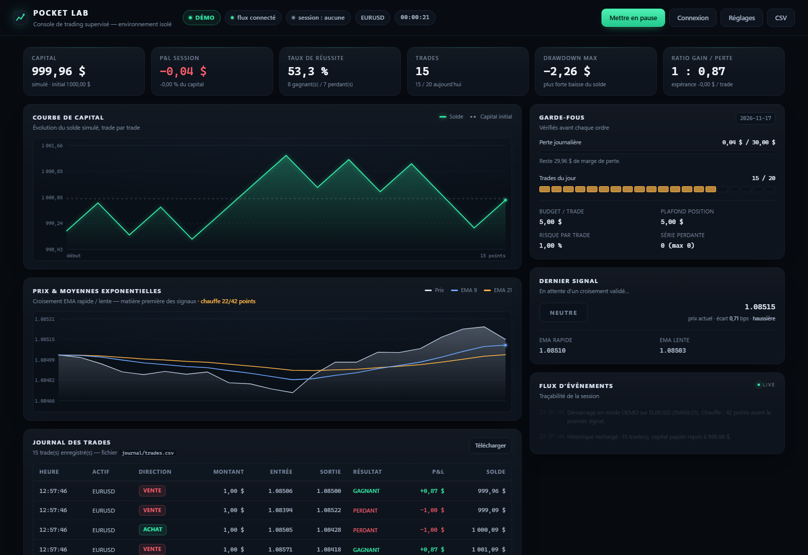

# Pocket Lab

**Console de trading supervisé pour produits binaires — simulation d'abord, prudence toujours.**

Pocket Lab est un projet pédagogique : un bot modulaire, testé et instrumenté qui
apprend à *ne pas* perdre le contrôle avant de gagner quoi que ce soit.

> ⚠️ **Aucune promesse de rentabilité.** Les produits dérivés binaires sont des
> instruments à risque élevé : la perte totale du capital est possible. Pocket Option
> ne fournit pas d'API officielle ; l'automatisation via un SSID de session peut violer
> ses conditions d'utilisation. Ce code est livré **en simulation uniquement**.



*Console de supervision : courbe de capital, prix et EMA, jauges de risque, position
ouverte et journal des trades, en temps réel (SSE).*

---

## Ce que fait le projet

| Module | Rôle |
|---|---|
| `bot/config.py` | Charge `.env`, valide et verrouille la configuration (double confirmation pour le réel). |
| `bot/connexion.py` | Flux de prix : simulateur reproductible ou client WebSocket avec reconnexion (backoff + jitter). |
| `bot/strategie.py` | Croisement d'EMA rapide/lente, filtres anti-bruit, cooldown, état exposé à l'UI. |
| `bot/risque.py` | Plafond de position, fraction de capital, perte journalière, quota de trades, reset UTC. |
| `bot/execution.py` | Verrous de mode + risque, ordres papier, résolution binaire, journalisation. |
| `bot/journalisation.py` | `trades.csv` (audit) + `evenements.jsonl` (traçabilité) + indicateurs de performance. |
| `bot/reglages.py` | Réglages modifiables à chaud (mise, plafonds, garde-fous, mode), validés côté serveur. |
| `bot/session.py` | Session plateforme : SSID **en mémoire uniquement**, test de connexion WebSocket honnête. |
| `bot/solde.py` | Solde affiché : capital papier, ou compte réel en lecture seule (adaptateur requis). |
| `bot/engine.py` | Boucle unique tick → signal → risque → ordre → résultat → diffusion. |
| `bot/serveur.py` | Console FastAPI : SSE temps réel, export CSV, pause/reprise, réglages et session. |
| `bot/web/*` | Interface sombre professionnelle : courbes SVG, jauges de risque, journal. |

---

## Démarrage rapide (Windows / PowerShell)

```powershell
cd "F:\MES PROJETS DEV\pocket-lab"

# 1. Environnement virtuel isolé
python -m venv .venv
.\.venv\Scripts\Activate.ps1

# 2. Dépendances
pip install -r requirements.txt

# 3. Configuration — un `.env` de démo est déjà présent (MODE_REEL=False).
#    Pour repartir du modèle :  copy .env.example .env

# 4. Console web
python main.py
# -> http://127.0.0.1:8080
```

Autres points d'entrée :

```powershell
python main.py --headless            # boucle dans le terminal, sans interface
python main.py --simulation 100      # 100 trades en temps virtuel + rapport
python scripts/simuler_100_trades.py --trades 100 --graines 5
pytest -q                            # suite de tests
```

> `.env` est ignoré par git. Ne le partagez jamais : il contiendra votre SSID
> le jour où vous passerez en réel.
>
> Sur Windows, le plus simple reste le double-clic sur **`demarrer.cmd`** : il
> crée le venv, installe les dépendances, génère `.env`, ouvre le navigateur et
> choisit automatiquement un port libre (8080 par défaut).

---

## Piloter la console : Réglages et Connexion

La console n'est pas un simple tableau de bord : c'est un panneau de contrôle.

**Réglages** (bouton *Réglages*) — appliqués immédiatement, sans redémarrer :

| Champ | Effet |
|---|---|
| Mise par trade | Montant engagé sur chaque signal validé |
| Plafond de position | Aucun ordre ne peut dépasser ce montant |
| Risque par trade | Plafond du budget calculé sur le capital (max 10 %) |
| Perte max / jour, trades max / jour | Auto-suspension du trading au-delà du seuil |
| Expiration, payout | Paramètres de l'ordre binaire |
| Mode | *Démo* (flux synthétique, capital papier) ou *Observation* (données plateforme, ordres papier) — *Réel* est verrouillé |
| Flux de prix | *Simulé* (générateur interne) ou *Binance · BTC/USDT* (prix réels, lecture seule, ordres papier) |

Les valeurs hors bornes sont refusées côté serveur (HTTP 400), la mise ne peut
jamais dépasser le plafond, et le mode réel est refusé avec une explication.
Le bouton *Valeurs .env* recharge la configuration du fichier.

## Flux MT5 (Weltrade, compte démo, lecture seule)

**La bibliothèque officielle MetaQuotes** permet enfin à ce projet de
**lire un solde réel** — jamais inventé :

```powershell
# 1. Installer le terminal Weltrade MT5 et ouvrir un compte DÉMO
#    (fait une fois sur https://www.weltrade.com/fr/trading/platform/mt5).
# 2. Activer dans `.env` :
MT5_DEMO=true
MT5_SYMBOLE=EURUSD_i
# Chemin par défaut : C:\Program Files\Weltrade MT5 Terminal\terminal64.exe
MT5_CHEMIN_TERMINAL=
```

La console affiche alors : les **ticks réels** du terminal (source `mt5_demo`) et le
**solde réel du compte démo** (« compte démo MT5 · lecture seule »), avec la même
sémantique de non-invention que partout ailleurs. Aucune position, aucun ordre
n'est transmis — l'exécution réelle sera une brique séparée, jamais surprise.
Note : cotations FX chez Weltrade sont libellées `EURUSD_i`… ; c'est un CFD à
levier (jusqu'à 1:2000 en démo) — même cadre « démo uniquement ».

## Flux Binance (public, papier)

Le flux *Binance* consomme le WebSocket public de Binance (`btcusdt@aggTrade`) :
**aucun compte, aucune clé, aucun ordre**. Il permet de mesurer la stratégie sur
de vrais prix, avec des trades papier. Le flux est limité à un tick/seconde ; si
l'hôte principal est filtré par votre réseau, le miroir public
`data-stream.binance.vision` prend le relais automatiquement. Changer de flux
réinitialise les EMA : on ne mélange jamais deux sources dans une même série.

Pour une mesure longue **sans consommer le quota journalier** (les garde-fous
du moteur suspendent le bot à `trades_max_par_jour`), utilisez le harnais dédié :

```powershell
# 30 minutes de prix réels, trades papier, CSV dans mesures/
.\.venv\Scripts\python.exe scripts\mesurer_flux_reel.py --duree 30

# plus d'échantillons : expiration courte, écarts plus permissifs
.\.venv\Scripts\python.exe scripts\mesurer_flux_reel.py --duree 120 --expiration 10 --cooldown 5
```

Il n'écrit rien dans `journal/` et affiche, à la fin, le taux de réussite, son
intervalle de confiance à 95 %, le seuil de rentabilité du payout et
l'espérance par trade. Un échantillon de 3 trades ne prouve rien : l'outil
l'écrit noir sur blanc.

**Backtest historique** (recommandé avant toute conclusion) : rejoue la même
stratégie sur des millions de vrais ticks —

```powershell
# 30 jours de klines 1 s, ~70 Mo, séparation calibration/test
.\.venv\Scripts\python.exe scripts\backtest_historique.py --jours 30
```

Compare plusieurs échéances sur la même série et publie le tableau
(réussite, IC 95 %, P/L, drawdown, verdict walk-forward).

**Le capital affiché est un capital papier.** Un flux de prix — Binance
compris — ne fournit **aucun solde** : il ne transporte que des prix. Le
1 000 $ de départ est la caisse du simulateur, réglée par les trades papier.
Aucun compte Binance n'est connecté, aucune clé n'est demandée. Un vrai solde
n'apparaîtra que le jour où un adaptateur de compte (Pocket Option) existera ;
en attendant l'interface affiche « indisponible » plutôt qu'un chiffre inventé.

**Repartir de zéro** (carte *Garde-fous*) :

| Bouton | Effet |
|---|---|
| Nouvelle campagne | Archive le journal, solde au capital initial, compteurs du jour à zéro. Les réglages restent ceux en cours. |
| Tout réinitialiser | Idem **plus** le retour de tous les réglages aux valeurs du `.env` (mise, plafonds, quotas, mode, flux). |

Dans les deux cas : le fichier `trades.csv` est **déplacé** vers
`journal/campagnes/` (jamais supprimé), le bot est arrêté, et le bouton
d'en-tête devient *Démarrer*. Un verrou mono-instance empêche deux consoles
d'écrire dans le même journal : la seconde refuse de démarrer avec le PID
fautif.

**Connexion** (bouton *Connexion*) — la session de la plateforme :

- **recommandée : « Se connecter avec votre navigateur »** — une fenêtre Edge
  s'ouvre sur la page de login ; vous tapez vos identifiants vous-même, la
  console ne les voit ni ne les enregistre. Elle relit ensuite la session et
  se connecte ;
- **ou** coller manuellement le jeton (SSID) dans le formulaire repliable ;
- le jeton reste **en mémoire vive uniquement** : jamais écrit sur disque,
  jamais journalisé, effacé à l'arrêt ou par *Effacer* ;
- il s'affiche **masqué** (`abcd…wxyz`), jamais en clair ;
- le test de connexion ouvre un vrai WebSocket et distingue « serveur
  joignable » (handshake socket.io) de « jeton validé » — il affiche
  `JOIGNABLE` dans le premier cas ;
- les trames WS capturées pendant votre connexion sont conservées
  localement dans `.audit/` pour reproduire le protocole, puis supprimées.

Aucune question d'email ou de mot de passe ne transite par la console :
votre navigateur fait le travail. Voir [`SECURITY.md`](SECURITY.md).

**Solde affiché.** En démo : votre capital papier. En mode *Observation* : le
solde du compte réel serait nécessaire — aucun adaptateur n'étant livré,
l'interface affiche explicitement « indisponible » au lieu d'inventer un
chiffre crédible. (Interface prête pour un adaptateur : le jour où il existe,
le solde devient lisible en lecture seule sans toucher à l'UI.)

Raccourcis : `/#reglages` et `/#session` ouvrent directement le panneau voulu.

---

## Architecture en un coup d'œil

```
                    ┌──────────────────────────────────────────┐
                    │              main.py                     │
                    │   console web  |  headless  |  campagne  │
                    └───────────────┬──────────────────────────┘
                                    │
        ┌───────────────────────────▼───────────────────────────┐
        │                   bot/engine.py                       │
        │        (boucle unique, un seul trade à la fois)       │
        └───┬───────────┬───────────────┬──────────────┬────────┘
            │           │               │              │
     ┌──────▼─────┐ ┌───▼────────┐ ┌────▼───────┐ ┌────▼─────────┐
     │ connexion  │ │ strategie  │ │   risque   │ │  execution   │
     │ flux prix  │ │  EMA 9/21  │ │ garde-fous │ │ ordres papier│
     └──────┬─────┘ └───┬────────┘ └────┬───────┘ └────┬─────────┘
            │           │               │              │
            │           └───────┬───────┴──────────────┘
            │                   │
     ┌──────▼───────────────────▼──────────────────────────────┐
     │                 bot/journalisation.py                   │
     │          trades.csv  +  evenements.jsonl               │
     └──────────────────────────┬──────────────────────────────┘
                                │
                    ┌───────────▼────────────┐
                    │  bot/serveur.py (SSE)  │
                    │   bot/web/ (console)   │
                    └────────────────────────┘
```

Deux modules transverses complètent le schéma :

- **`bot/reglages.py`** — la configuration *vivante*. `.env` fournit le point de
  départ ; la console applique ensuite les changements en place (aucune
  référence conservée ne devient obsolète) et pousse les limites dans
  `risque` / `execution` sans redémarrage.
- **`bot/session.py`** et **`bot/solde.py`** — la session plateforme et le
  solde affiché. Le SSID vit en mémoire, le solde dit toujours d'où il vient
  (« simulé », « plateforme » ou « indisponible »).

Détails, séquences et points d'extension : [`ARCHITECTURE.md`](ARCHITECTURE.md).

---

## Le principe de sécurité

Le projet est conçu pour qu'il soit **impossible** de trader en réel par accident :

1. `MODE_REEL` doit exister dans `.env`, sinon le bot refuse de démarrer.
2. `MODE_REEL=True` exige en plus `SSID` **et** `CONFIRMATION_REELLE` (texte exact).
3. Même dans ce cas, `main.py` échoue avec le code 3 : aucun adaptateur courtier réel
   n'est livré ; et `bot/execution.py` lève `ExecutionReelleBloquee`.
4. La console web n'affiche que des données dérivées ; le SSID n'y apparaît jamais
   (aperçu masqué `abcd…wxyz`), et le panneau *Connexion* le garde en mémoire vive
   au lieu de le écrire sur disque.

Guide complet : [`SECURITY.md`](SECURITY.md).

---

## Feuille de route

- [x] Simulation papier complète, journalisation, console temps réel
- [x] Garde-fous de risque testés unitairement
- [x] Campagne de 100 trades reproductible
- [x] Panneau de contrôle : réglages à chaud + session SSID en mémoire
- [x] Mode Observation (données plateforme, ordres papier)
- [ ] Adaptateur courtier réel (à écrire par vos soins, après audit)
- [ ] Backtest sur données historiques réelles
- [ ] Walk-forward et tests de robustesse multi-régimes

---

## Licence et responsabilité

Projet fourni à des fins d'apprentissage. Vous êtes seul responsable de son usage,
du respect des conditions de la plateforme et de vos décisions de trading.
